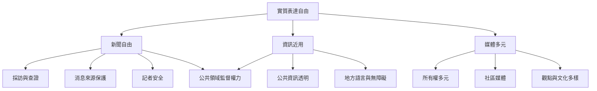

本圖將新聞自由從單一媒體的免受審查，擴展到採訪安全、媒體多元、資訊近用、地方語言與公共領域。制度環境必須使不同群體能夠取得資訊，也能把自身經驗帶入公共討論。

延伸閱讀 [[新聞自由涵蓋採訪蒐集資訊而不只是刊播內容]]、[[言論自由需要媒體多元與資訊可近用作為物質條件]]、[[表達自由必須看見語言與文化少數的參與門檻]]；概念參見 [[Press_freedom|新聞自由]]、[[Media_pluralism|媒體多元]]、[[Access_to_information|資訊近用]]。

本卡片屬於 [[Freedom_of_speech|言論自由專書]]。
