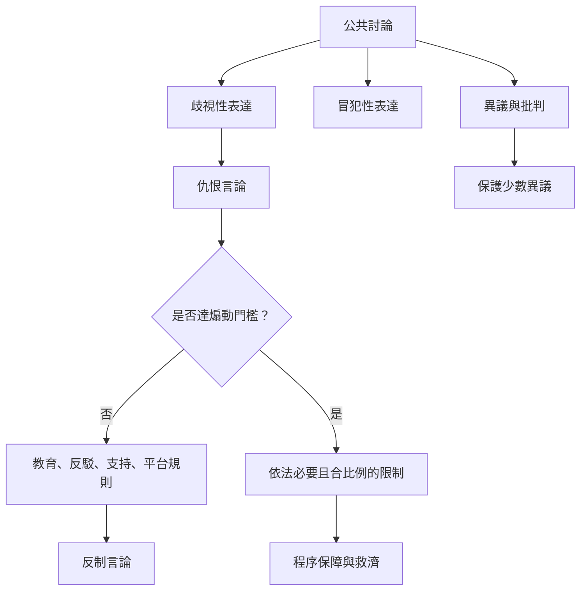

本圖聚焦異議表達、仇恨言論與社會回應之間的張力。它提醒讀者區分冒犯、歧視、騷擾與煽動，並讓反制言論、受害者支持與比例適當的法律手段共同發揮作用。

相關討論見 [[言論自由必須保護令人不快與挑戰多數的觀點]]、[[反制言論可以回應傷害而不把不同意見全部交給刑罰]]、[[仇恨言論政策必須同時看見語言傷害與國家規制權力]]；概念參見 [[Hate_speech|仇恨言論]]、[[Counter_speech|反制言論]] 與 [[Public_sphere|公共領域]]。

本卡片屬於 [[Freedom_of_speech|言論自由專書]]。
