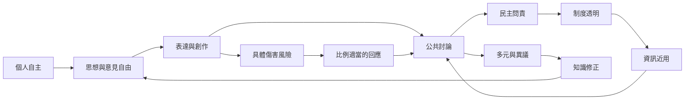

本圖呈現表達自由與多元社會之間的互賴：個人需要思想與表達空間，社會則需要資訊近用、媒體多元與平等參與；法律限制應避免權力濫用，也需要在具體傷害出現時提供有效保護。

相關論點見 [[言論自由必須保護令人不快與挑戰多數的觀點]]、[[不同法域會依歷史脈絡採取不同的言論自由邊界]]、[[意見自由與表達自由不可混為一談]]；概念參見 [[Public_sphere|公共領域]]、[[Freedom_of_opinion|意見自由]]、[[Freedom_of_expression|表達自由]]。

本卡片屬於 [[Freedom_of_speech|言論自由專書]]。
