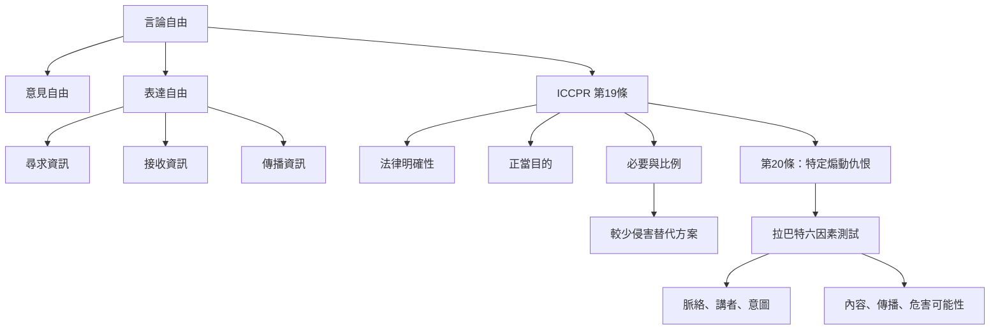

本圖整理表達自由的權利內容、國際人權法上的限制條件，以及仇恨煽動的高門檻判斷。核心不是讓言論完全不受規範，而是要求限制者公開證明其必要性與比例性。

這張地圖連結 [[言論自由保障的不只是說話也保障尋求接收資訊與跨境傳播]]、[[比例原則讓言論限制必須由限制者提出理由]]、[[仇恨言論不應與煽動歧視敵意或暴力直接畫上等號]]；概念定義參見 [[Freedom_of_expression|表達自由]]、[[Freedom_of_opinion|意見自由]]、[[Proportionality|比例原則]]、[[Incitement|煽動]] 與 [[Rabat_Plan_of_Action|拉巴特行動計畫]]。

本卡片屬於 [[Freedom_of_speech|言論自由專書]]。
