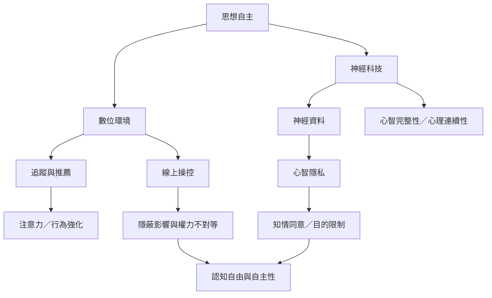

本圖把傳統思想自由延伸到資料化與神經科技環境，分辨注意力、演算法、線上操控、神經資料與心智隱私等風險。

## 概念與論點
* [[思想自由的保障需要隱私與資訊多元作為條件]]
* [[平台的個人化設計可能限制注意力與自主判斷]]
* [[思想自由需要防止操控而非禁止說服]]
* [[心智隱私應被視為高度敏感的個人資料保護議題]]
* [[神經資料推論不等於讀取完整而確定的思想]]
* [[認知自由要求人能自主決定是否接受心智介入]]
* [[聯合國隱私權特別報告員2025年報告要求嚴格保護神經資料]]
* [[注意力自主]]
* [[心智隱私]]
* [[認知自由]]
* [[神經資料]]
* [[自主性]]
* [[操控]]
