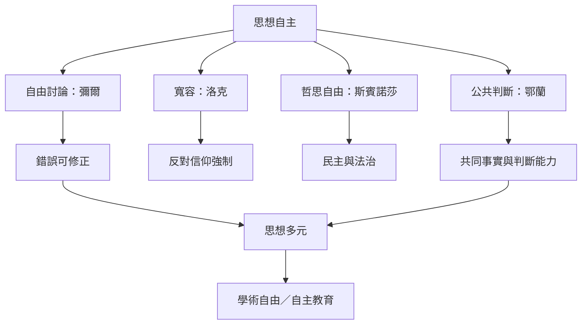

本圖連結寬容論、哲學自由、自由討論與民主判斷，並說明多元資訊、公共事實、學術制度與自主教育如何共同支撐思想自由。

## 概念與論點
* [[思想自由是民主治理與法治的重要條件]]
* [[思想多元能降低單一權威壟斷真理的風險]]
* [[自由討論讓錯誤可被修正也讓真理避免僵化]]
* [[強制可以改變外在服從卻不能保證產生真誠信念]]
* [[當公共事實崩解時思想自主也會失去社會條件]]
* [[教育的任務是培養自主判斷而不是指定正確思想]]
* [[學術自由是思想自由的公共制度條件]]
* [[批判思考]]
* [[認識論]]
* [[民主]]
* [[法治]]
* [[思想灌輸]]
