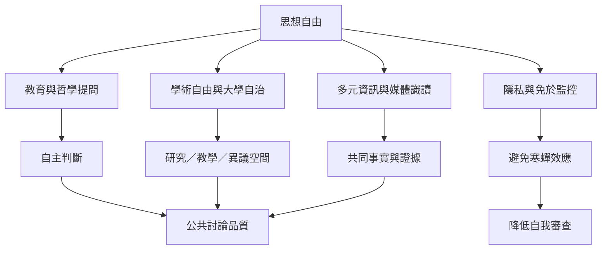

本圖整理思想自由如何由教育方法、媒體與資訊品質、學術制度、隱私與公共空間支撐；也呈現寒蟬效應和自我審查如何侵蝕這些條件。

## 概念與論點
* [[教育的任務是培養自主判斷而不是指定正確思想]]
* [[學術自由是思想自由的公共制度條件]]
* [[寒蟬效應會使人們在正式審查前先行自我審查]]
* [[當公共事實崩解時思想自主也會失去社會條件]]
* [[思想自由的保障需要隱私與資訊多元作為條件]]
* [[學者受攻擊年度報告呈現學術自由在不同國家面臨的壓力]]
* [[思想自由]]
* [[批判思考]]
* [[資訊自由]]
* [[寒蟬效應]]
* [[自我審查]]
* [[大學自治]]
