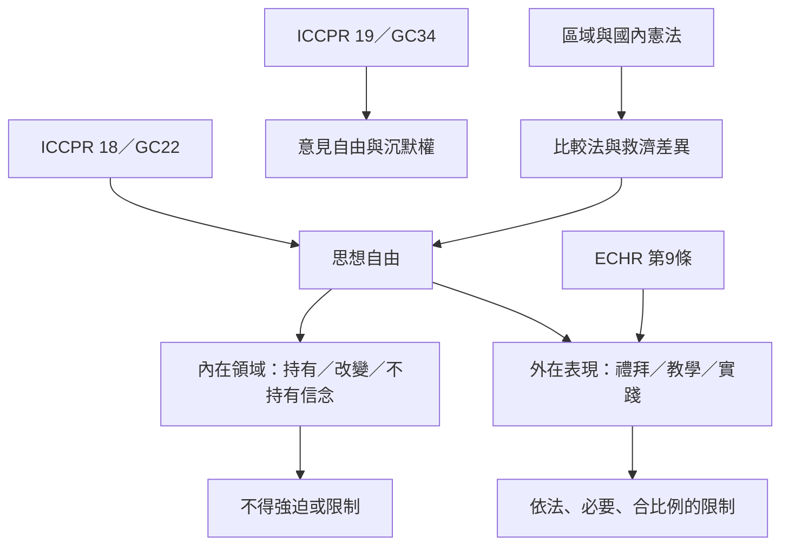

本圖整理國際人權法、區域人權制度與國內憲法如何界定內在信念、外在實踐、意見與表達。比較時須區分條文文字、司法解釋與實際執行。

## 概念與論點
* [[內在思想自由不應受限制而外在信念表現才可能受限制]]
* [[思想自由不只保障表達也保障內在信念不受強迫]]
* [[不信仰與不表態也是思想自由的一部分]]
* [[思想自由必須包含沉默與不表態的權利]]
* [[各地憲法對思想自由的明文程度與實際保障並不相同]]
* [[台灣思想自由的憲法基礎需要分辨明文保障與解釋推導]]
* [[比例原則]]
* [[內在領域]]
* [[外在表現]]
* [[良心自由]]
* [[宗教自由]]
* [[意見自由]]
