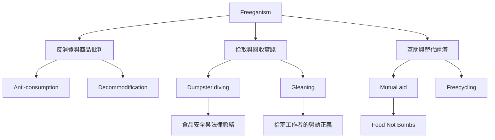

Freeganism 位於反消費、食物系統批判與替代生活實踐的交會處。它不只關乎如何取得免費食物，也關乎商品價值如何形成、浪費如何被制度化，以及人們能否透過分享、交換與互助建立不同的生活關係。理解本主題時，需同時看見自願抗議與被迫拾荒的差異。

閱讀入口：[[Freeganism]]、[[Freeganism是一種降低參與商品經濟的反消費實踐]]、[[Freeganism核心不只是免費取得而是拒絕浪費與商品邏輯]]。

實證脈絡：[[Freegans：美國食物浪費與反消費運動的民族誌]]、[[澳洲Freegan實踐結合垃圾翻找與Food Not Bombs]]、[[香港Freegan與Freecycling將自由理解為倫理實踐]]、[[全球Dumpster_Diving研究需同時理解容器與翻找實踐]]。

核心張力：[[自願Freegan與被迫拾荒者必須區分]]、[[反消費若只依賴個人純潔容易變成道德競賽]]、[[內在動機與行動後果需要分開評估]]。
