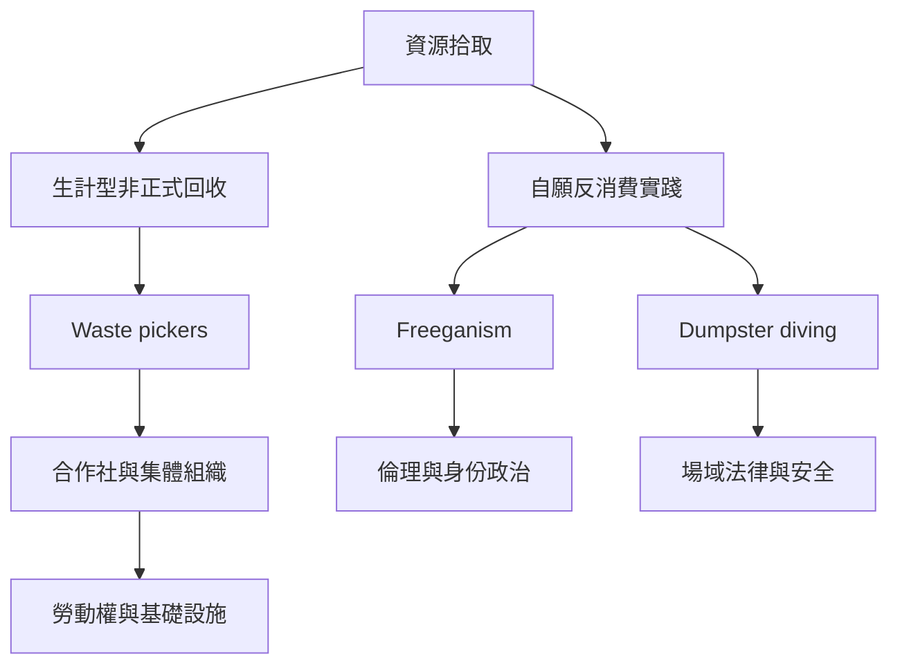

不同地區的拾取行為，可能是自願的反消費抗議，也可能是受經濟排除的人們維生的工作。相似的動作不代表相同的社會位置；全球比較必須納入污名、收入、風險、組織能力、法律規則與公共服務。

相關概念：[[Dumpster_Diving]]、[[Gleaning]]、[[Waste_Picker]]、[[Informal_Economy]]、[[Food_Insecurity]]、[[Food_Justice]]。

永久筆記：[[自願Freegan與被迫拾荒者必須區分]]、[[非正式拾荒勞動需要權利與基礎設施而非浪漫化]]。

資料依據：[[全球Dumpster_Diving研究需同時理解容器與翻找實踐]]、[[全球都市拾荒不只是反消費也包含生計勞動]]、[[印度德里非正式食物回收者支撐城市食物安全]]、[[巴西拾荒者合作社展現回收工作者的集體組織]]。

本筆記亦屬於 [[Freeganism]] 主題書庫。
