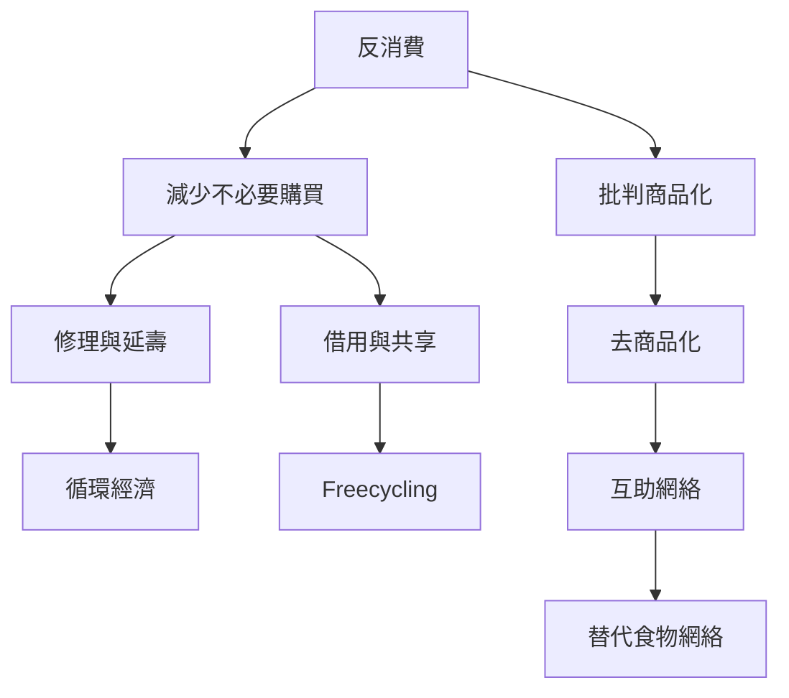

反消費不是單純減少花費，而是重新檢視市場購買在生活中扮演的角色。替代經濟由交換、免費分享、修理、借用、合作社與互助構成；它可能與正式市場並存，不必以完全退出市場作為唯一目標。

相關概念：[[Anti_Consumption]]、[[Ethical_Consumption]]、[[Decommodification]]、[[Freecycling]]、[[Mutual_Aid]]、[[Alternative_Food_Networks]]、[[Circular_Economy]]。

永久筆記：[[替代經濟以多樣性而非完全退出市場為特徵]]、[[自由來自自我限制與共同實踐]]、[[反消費社群應避免將資源占有變成新的排他規則]]。

資料依據：[[Freegans：美國食物浪費與反消費運動的民族誌]]、[[香港Freegan與Freecycling將自由理解為倫理實踐]]、[[Freegan原始宣言將反消費延伸為日常倫理]]。

本筆記亦屬於 [[Freeganism]] 主題書庫。
