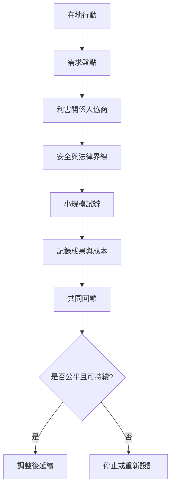

把 freegan 觀念帶入在地生活時，適合由小規模、可撤回、能持續檢討的行動開始。行動設計應先盤點需求與合作關係，再確定食安、法律、分工與資源規則；活動不以回收量或媒體曝光作唯一成功指標。

行動卡：[[建立社區續食餐桌時先以需求盤點而非收集量為起點]]、[[為每次食物分享建立最小食安紀錄]]、[[在台中建立可撤回的小規模剩食共享協議]]、[[與店家合作從源頭預測剩食而不只收尾]]。

延伸行動：[[將免費取得擴展為修理借用交換與共同維護]]、[[設計不羞辱受助者的開放共享餐桌]]、[[讓Freegan實踐與Waste_Picker組織建立平等合作]]。

本筆記亦屬於 [[Freeganism]] 主題書庫。
