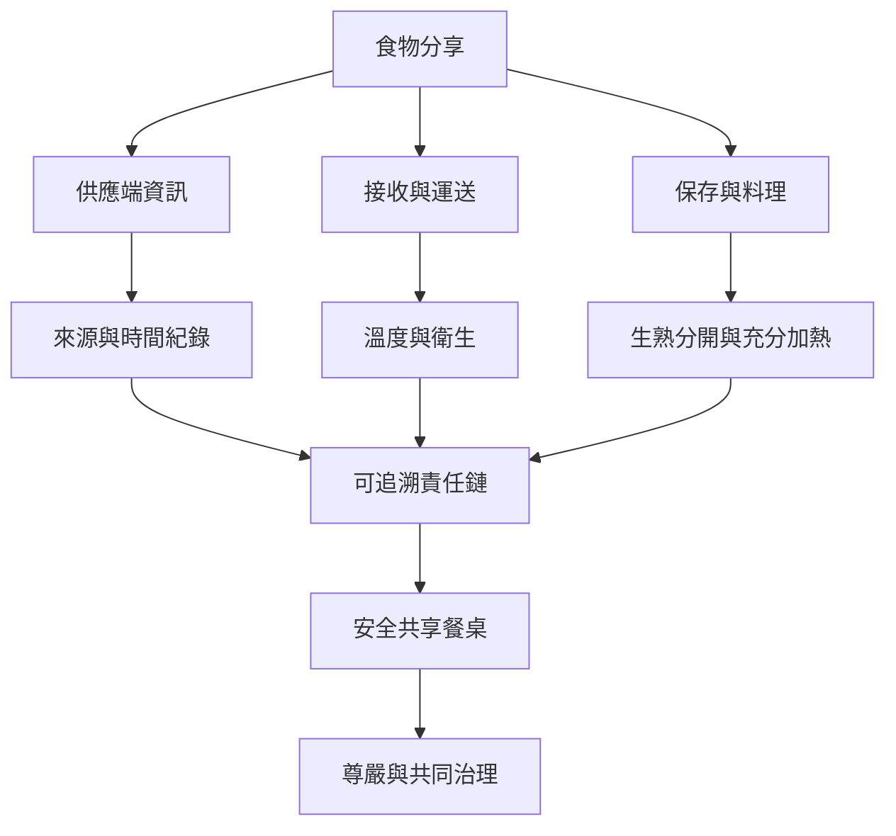

互助與食物分享要同時維護參與者的尊嚴和食品安全。善意不能取代可追溯的來源、衛生、保存溫度、交接責任與拒收權；能夠拒絕不安全食物，本身就是安全共享的一部分。

相關概念：[[Food_Safety]]、[[Food_Rescue]]、[[Surplus_Food]]、[[Mutual_Aid]]、[[Food_Not_Bombs]]、[[Food_Justice]]。

永久筆記：[[食品安全必須被視為互助的共同責任]]、[[共享食物能把廢棄物問題轉化為社群關係]]。

資料依據：[[世界衛生組織食品安全五要點提供剩食處理底線]]、[[歐盟剩食捐贈指引把再分配納入食安追溯責任]]、[[Food_Not_Bombs以免費素食餐建立互助政治]]。

本筆記亦屬於 [[Freeganism]] 主題書庫。
