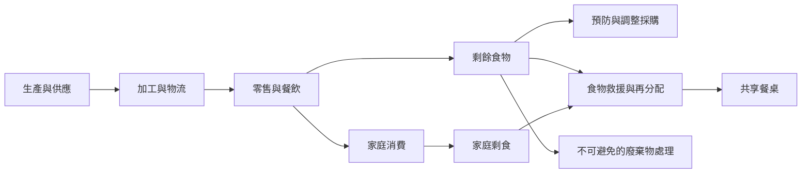

Freeganism 的食物實踐必須放回完整食物系統：從生產與供應鏈流失，到零售、餐飲與家庭浪費，再到剩食救援、共享與不可食部分的處理。只關注垃圾桶會遮蔽更前端的過量生產與需求預測問題。

相關概念：[[Food_Loss]]、[[Food_Waste]]、[[Surplus_Food]]、[[Food_Rescue]]、[[Food_Safety]]、[[Food_Insecurity]]。

永久筆記：[[剩食轉用只能緩解浪費不能正當化過度生產]]、[[食物救援應遵循預防優先於再分配的階層]]、[[共享食物能把廢棄物問題轉化為社群關係]]。

資料依據：[[全球食物浪費的規模使個人拾取無法取代制度改革]]、[[台灣家庭食物浪費研究指出知識技能與分享是關鍵]]、[[日本Mottainai實踐透過日常習慣減少食物浪費]]。

本筆記亦屬於 [[Freeganism]] 主題書庫。
