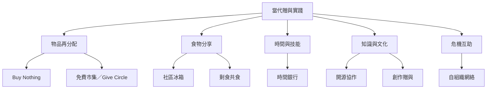

本地圖聚焦當代可實踐的贈與與非市場協作：物品再分配、免費市集、社區冰箱、剩食分享、時間銀行、開源知識與危機互助。每種實踐都需要不同的基礎設施與治理方式。

相關概念：[[互助]]、[[公地]]、[[時間銀行]]、[[去商品化]]、[[開源]]、[[共食]]。

實踐文獻：[[Buy Nothing把日常物品再分配變成地方數位贈與]]、[[社區冰箱需要共同維護才能成為食物公地]]、[[台灣免費市集以集體行動協調非貨幣流通]]。
