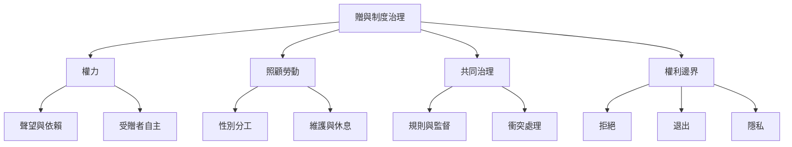

贈與經濟的關鍵問題不只是如何鼓勵更多給予，而是如何讓關係平等、安全且可持續。本地圖整理四個治理問題：權力與階序、照顧工作分配、共同資源維護，以及可拒絕與退出的權利。

相關概念：[[共同治理]]、[[公地]]、[[照顧勞動]]、[[社會再生產]]、[[去商品化]]。

核心筆記：[[贈與不是沒有權力的純粹善意]]、[[照顧勞動必須被看見與公平分配]]、[[贈與的可持續性取決於退出權與邊界]]、[[互惠制度需要可檢驗的評估方式]]。
