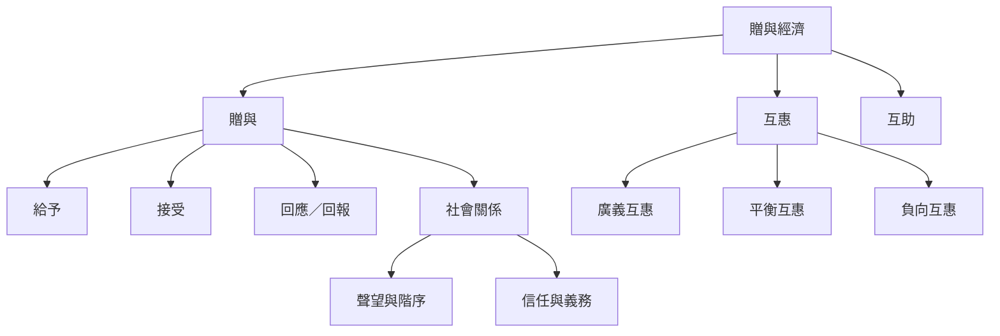

本地圖整理贈與研究的基本概念：贈與如何建立關係、互惠如何在時間中運作，以及贈與如何與市場、宗教、身份和權力交織。閱讀時先掌握 Mauss，再以 Sahlins 的互惠分類作為比較工具，最後回到不同文化的具體案例。

相關概念：[[贈與經濟]]、[[贈與]]、[[互惠]]、[[廣義互惠]]、[[平衡互惠]]、[[負向互惠]]、[[互助]]。

核心文獻：[[贈與義務同時包含給予接受與回報]]、[[互惠可以分為廣義平衡與負向三種形式]]、[[贈與不是沒有權力的純粹善意]]。
