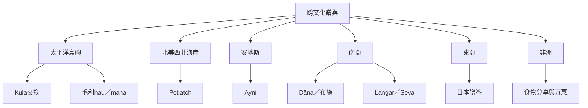

本地圖把贈與研究放回各自的文化與歷史脈絡。Kula、Potlatch、hau、ayni、dāna、langar 與日本贈答不應被當成同一制度，而是比較不同社會如何藉由物品、食物、勞動與儀式維繫關係。

相關概念：[[庫拉交換]]、[[波特拉奇]]、[[hau]]、[[mana]]、[[ayni]]、[[dāna]]、[[langar]]、[[seva]]。

案例文獻：[[庫拉交換讓珍貝在島嶼網絡中循環]]、[[毛利hau概念提醒研究者尊重原住民自身詮釋]]、[[玻利維亞ayni在發展論述中可能被重新定義]]、[[錫克教langar結合共食與無私服務]]。
