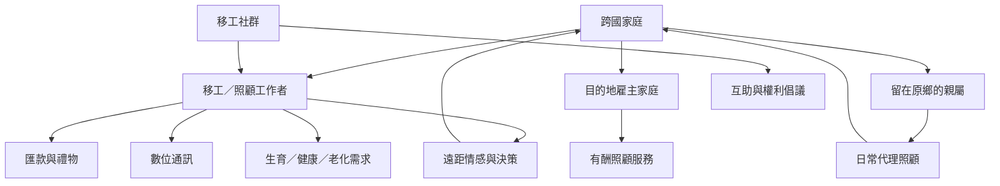

這張地圖以移工及其跨國家庭為中心，整理分離、遠距母職、匯款、代理照顧、社群互助與生命歷程。核心問題不是「有沒有照顧」，而是照顧如何被拆分、交接、協商與感受。

## 核心閱讀
* [[移工的離開會把照顧責任重新分配給留在原鄉的人]]
* [[匯款可以支持遠距照顧卻無法完全替代共同生活]]
* [[數位通訊能維繫遠距關係卻不能消除制度造成的分離]]
* [[照顧者本身也需要照顧與社會保障]]
* [[移工不只是照顧鏈中的勞動力也是互助網絡的組織者]]
* [[照顧的道德評價常把結構性問題轉嫁給女性個人]]
* [[臺灣照顧制度將家庭責任與移工勞動緊密連結]]
* [[全球照顧鏈也應追蹤照顧者生命歷程與老年風險]]

## 概念連結
[[跨國母職]] · [[跨國家庭]] · [[匯款]] · [[照顧循環]] · [[情感勞動]] · [[照顧者流失]]
