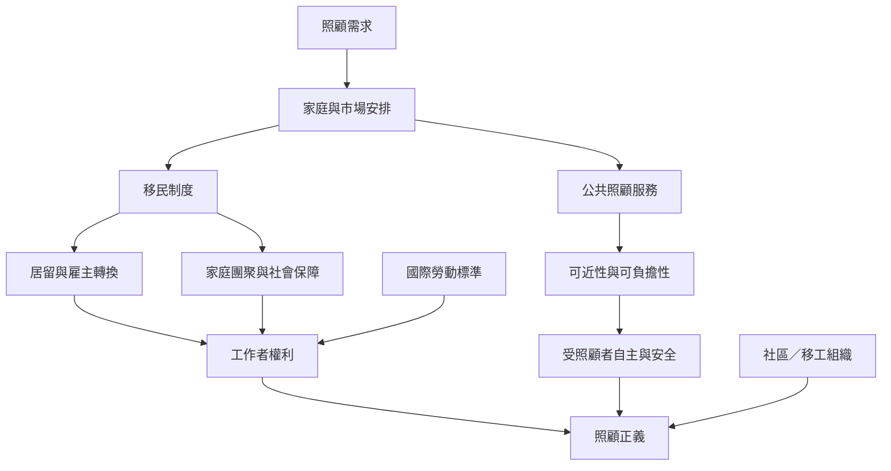

全球照顧鏈由家庭需求、勞動市場、移民制度與社會政策共同塑造。這張地圖把制度條件與公平標準放在一起：移工能否安全工作、轉換雇主、團聚家庭、取得社會保障，與受照顧者能否獲得可負擔且尊嚴的照顧，必須同時評估。

## 核心閱讀
* [[暫時性移工制度可能以家庭分離換取低成本照顧]]
* [[私人住宅不能成為勞動權利與公共監督的盲區]]
* [[全球照顧鏈的公平性取決於目的地與來源地共同承擔制度責任]]
* [[照顧危機不只是家庭問題而是公共制度的配置問題]]
* [[照顧正義必須同時處理照顧者與受照顧者的權利]]
* [[照顧移工制度不是文化的自然結果而是政策選擇]]

## 概念連結
[[體面勞動]] · [[照顧正義]] · [[照顧經濟]] · [[移民制度]] · [[雇主擔保制度]] · [[家事工作者]]
