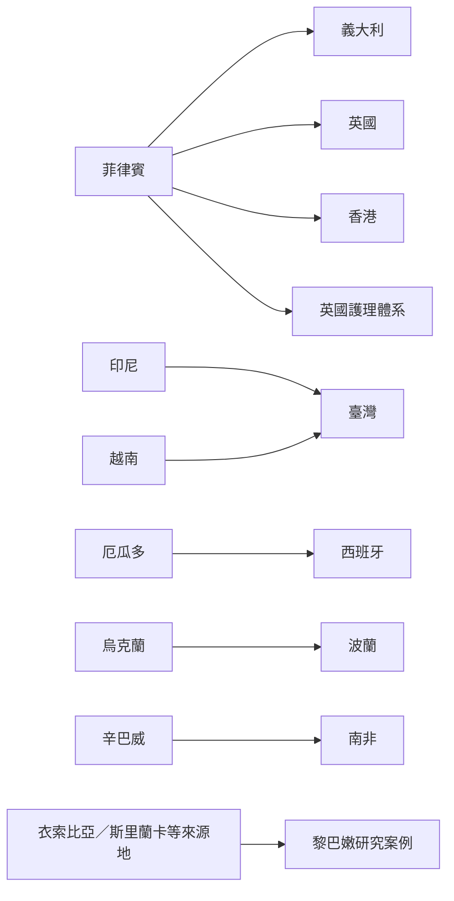

全球照顧鏈不是固定的南方到北方單一路徑，而是由不同區域的勞動市場、家庭制度與移民政策交織而成。以下關係圖呈現本書納入的主要案例走廊；箭頭代表研究所討論的跨境工作或家庭關係，不代表完整移民流量統計。

圖中部分連線是本書收錄的個案研究，不應被解讀為該國唯一或主要照顧移工來源。尤其黎巴嫩案例與海灣國家制度不可混為一談。

## 區域案例
* 菲律賓—義大利／英國／香港：[[菲律賓女性移工的家務勞動揭示全球照顧與階級流動的矛盾]]、[[菲律賓移工在疫情期間以社群互助擴大照顧的多向流動]]
* 印尼—臺灣：[[印尼看護移工透過匯款禮物與通訊實踐跨境母職]]、[[臺灣印尼看護移工以照顧循環維持家庭卻仍受暫時性制度限制]]
* 越南—臺灣：[[越南婚姻移民女性的家庭照顧呈現跨代與跨境的雙重負擔]]
* 厄瓜多—西班牙：[[厄瓜多女性在西班牙從事老人照顧仍需遠距照顧原鄉長者]]
* 東歐區域：[[東歐女性跨境工作使理想母職與家庭經濟責任發生衝突]]
* 辛巴威—南非：[[辛巴威女性在南非家戶工作揭示南部非洲的跨境照顧安排]]
* 黎巴嫩：[[黎巴嫩家事移工的雇主擔保制度使性別與種族階序進入私人住宅]]
* 跨國護理：[[護理人員跨國移動也構成全球照顧鏈而不只家事工作]]

## 概念連結
[[全球照顧鏈不只發生在南北移動也存在區域內與南南移動]] · [[跨國家庭]] · [[照顧移工]] · [[移民制度]]
