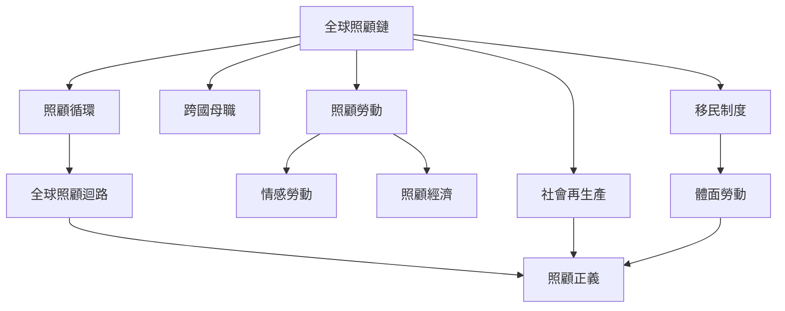

本圖整理全球照顧鏈的概念核心、分析層次與理論修正。起點是跨國照顧勞動如何重新分配社會再生產責任；接著檢視情感勞動、性別分工與移民制度如何構成不平等；最後以照顧循環與照顧迴路補足線性模型。

## 核心閱讀
* [[全球照顧鏈將跨國移工與家庭照顧缺口連成同一個分析單位]]
* [[全球照顧鏈的研究從單一鏈條延伸至多尺度跨國網絡]]
* [[全球照顧鏈適合解釋結構性轉移但不應被當成所有照顧經驗的唯一模型]]
* [[照顧循環與照顧迴路能補捉照顧關係的多向流動]]
* [[互惠不代表照顧關係中的權力與成本已經平等]]
* [[護理與家務照顧都屬照顧經濟但需要分開分析]]
* [[婚姻移民與契約移工必須放在不同制度位置理解]]

## 概念連結
[[全球照顧鏈]] · [[社會再生產]] · [[照顧勞動]] · [[照顧循環]] · [[全球照顧迴路]] · [[照顧經濟]] · [[照顧正義]] · [[交織性]]
