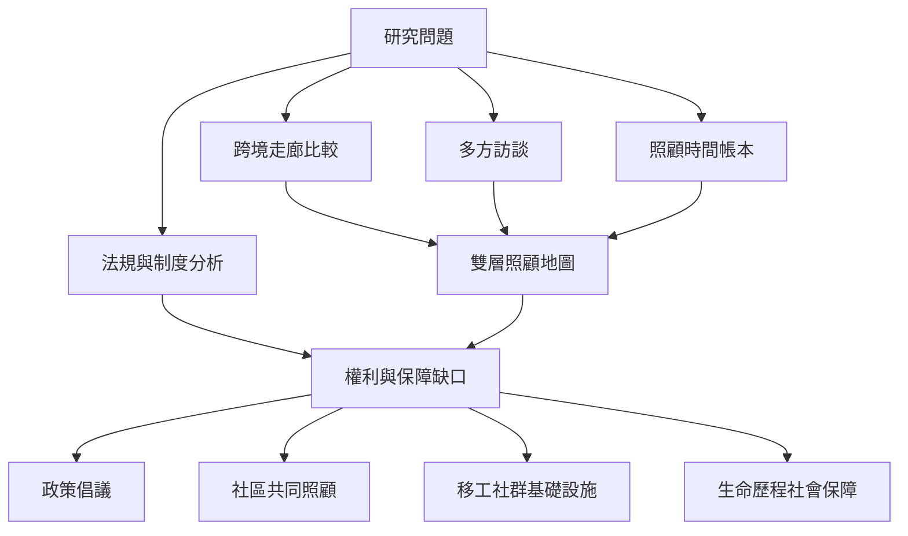

此地圖將研究策略與可實踐的制度行動放在一起。研究者需要同時蒐集勞動條件、家庭敘事、時間使用、移民法規與社群組織資料；行動者則可將照顧缺口轉化為公共政策與社區支持方案。

## 方法卡與行動卡
* [[用一張雙層地圖同時呈現照顧資源流動與權力不對稱]]
* [[以照顧時間帳本揭露家庭與移工承擔的隱形工時]]
* [[用五個問題檢查一條照顧鏈是否公平]]
* [[以移工與原鄉家庭共同敘事重寫照顧鏈研究]]
* [[將移工的社群互助轉化為可持續的集體照顧基礎設施]]
* [[文獻分布不等於照顧勞動實際分布]]
* [[跨國移民統計不能直接當成跨國照顧勞動統計]]
* [[用照顧者生命歷程重新設計移工社會保障]]
* [[比較不同移民走廊時應同時畫出法規與照顧關係]]
* [[建立不以移工犧牲為前提的高齡照顧方案]]

## 概念連結
[[照顧正義]] · [[社會再生產]] · [[照顧經濟]] · [[體面勞動]] · [[交織性]]
