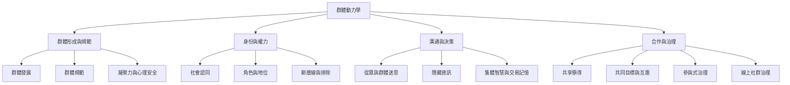

群體動力學可分成「群體形成與秩序」「身份、權力與關係」「溝通、資訊與決策」「合作、儀式與治理」等互相交疊的層次。以下地圖把微觀互動連到制度和跨文化實踐。

概念連結：[[群體動力學]]、[[群體過程]]、[[群體]]、[[群體規範]]、[[社會認同]]、[[心理安全感]]、[[集體智慧]]、[[參與式行動研究]]。

## 思與行
* 先以群體的具體場景為起點，再沿圖追問規範、身份、資訊與資源如何相互影響。
* 不把任何一個概念當作萬用解釋；對照多個層次才能避免單因論。

## 參考
* [[群體是互相依存的關係場而非個人特質總和]]、[[群體程序的公平包含代表權與決策權]]、[[文化概念必須放回歷史與權力脈絡理解]]。
