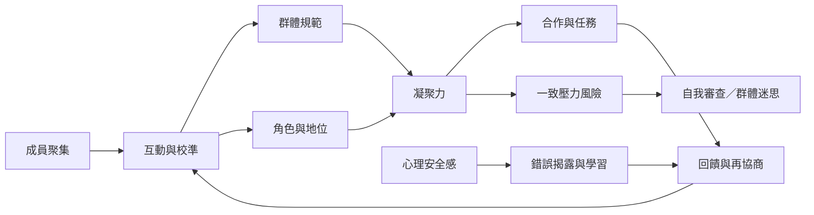

這張地圖聚焦群體如何從聚集轉為相對穩定的互動秩序：成員彼此校準，形成規範、角色與地位；凝聚力和心理安全感影響是否能持續合作與學習。

概念連結：[[群體規範]]、[[群體角色]]、[[群體地位]]、[[群體凝聚力]]、[[心理安全感]]、[[從眾]]、[[群體迷思]]。

## 思與行
* 把團體規範當成可被共同檢查的產物，而非自然或永恆的規則。
* 區分健康凝聚與壓抑異議的一致壓力。

## 參考
* [[小團體發展常經歷形成衝突規範與執行階段]]、[[群體規範會在不確定情境中透過彼此校準形成]]、[[團隊心理安全感與學習行為具有實證關聯]]。
