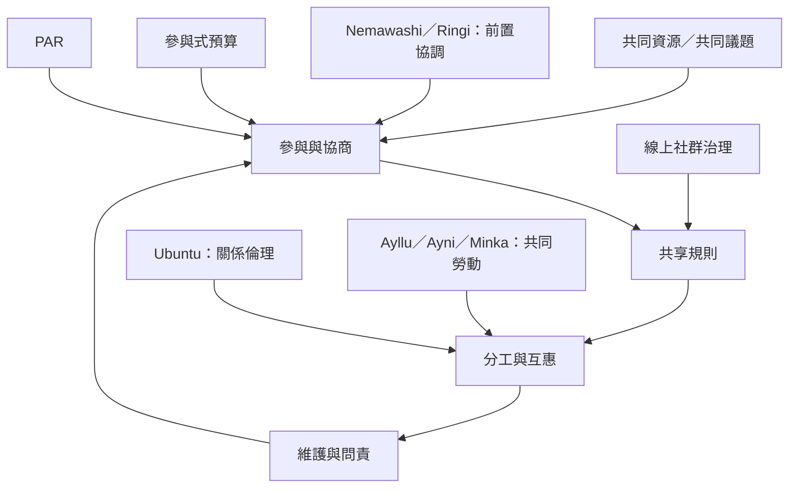

群體合作可以透過共同規則、互惠制度、參與式決策、儀式和線上治理來維持。不同地方的制度不是可直接複製的模板，而是理解共同生活如何被組織的案例。

概念連結：[[參與式預算]]、[[參與式行動研究]]、[[共同池資源]]、[[Ubuntu]]、[[Ayllu]]、[[Ayni]]、[[Minka]]、[[Nemawashi]]、[[Ringi]]。

## 思與行
* 借鏡案例時先理解其制度條件、地方歷史與權力安排，再決定哪些原則可轉化。
* 把共同資源、責任、申訴與規則修訂納入群體設計。

## 參考
* [[巴西參與式預算讓居民把共同討論連結到公共資源分配]]、[[安地斯 ayllu 與 ayni 展現社群互惠和共同勞動制度]]、[[參與式行動研究重新分配研究者與參與者的知識權力]]。
