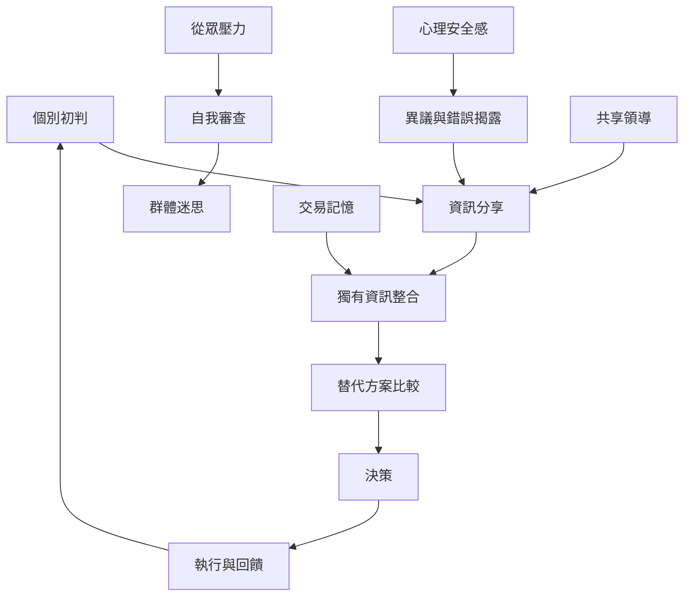

群體決策品質取決於成員如何形成初判、交換獨有資訊、處理異議和整合知識。若過早追求共識，群體容易重複共同資訊並陷入群體迷思；若讓心理安全、輪替發言與反方檢驗成為程序，分散知識較可能進入決策。

概念連結：[[從眾]]、[[群體迷思]]、[[心理安全感]]、[[集體智慧]]、[[交易記憶系統]]、[[共享領導]]。

## 思與行
* 重大決策採獨立初判、輪流分享、資訊整合、反方檢驗與回顧的流程。
* 把資訊品質與參與公平一併納入決策紀錄。

## 參考
* [[重大決策應先蒐集獨立判斷再追求共識]]、[[團體常偏好重複共同資訊而漏掉分散線索]]、[[群體智慧取決於互動模式而不只是成員能力]]。
