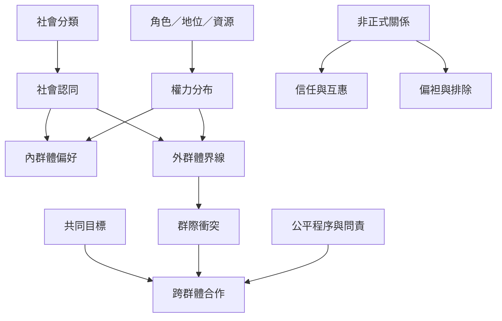

群體身份在建立歸屬時也畫出邊界；角色、地位與資源分配會決定誰有能力定義「我們」。群際競爭、非正式關係與文化敘事可能加深排除，也可能透過共同目標、制度改革與相互承認重新安排關係。

概念連結：[[社會認同]]、[[群際關係]]、[[群體斷層線]]、[[共同目標]]、[[Ubuntu]]、[[關係（Guanxi）]]。

## 思與行
* 問清楚身份與資源如何交織，而不把衝突簡化成個性或文化差異。
* 設計跨群體合作時，確保各方具有實際影響力和公平的利益安排。

## 參考
* [[群體認同同時提供歸屬也可能製造排除]]、[[共同目標能改變群際互動的誘因結構]]、[[非正式關係能建立信任也可能形成排除]]。
