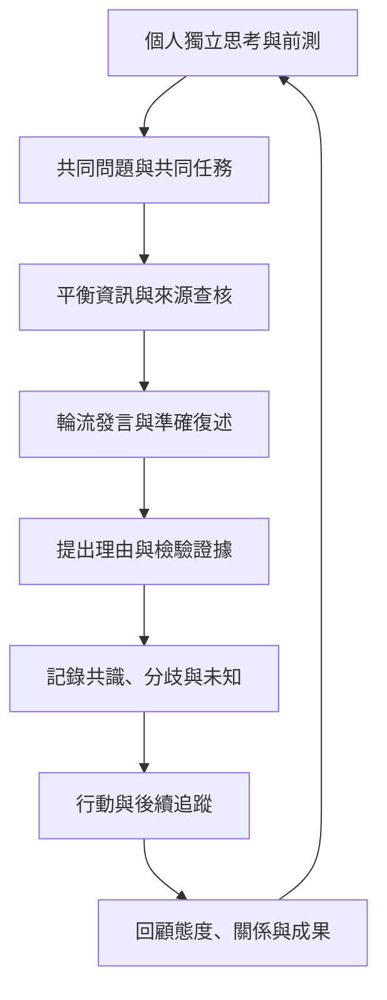

降低破壞性極化，不等於要求所有人達成一致。更好的目標是讓立場形成過程透明、證據可以被核對、少數意見有位置、參與者能準確理解彼此，並把討論接回持續合作。

流程設計重點包括：獨立形成初步判斷、降低身份威脅、提升論據品質、管理發言權力、保留異議與建立長期合作。相關概念：[[term/Deliberative_democracy|審議民主]]、[[term/Deliberative_polling|審議式民調]]、[[term/Opinion_climate|意見氣候]]。

## 思與行
- 從小型讀書會或社區聚會試行，不必一開始就複製大型公民議會。
- 用前後測、情緒溫度、發言分配與後續參與追蹤成效。
- 把未解問題保留為下一輪查證與合作的起點。

## 參考
- [[note/審議的結果取決於程序設計而非討論本身|審議程序設計]]。
- [[idea/每次小組討論都先留下獨立立場再進入交流|討論前後測]]、[[idea/把復述對方論點設為發言前的共同規則|準確復述規則]]、[[idea/讓小組討論保留少數意見與未解問題|保留異議]]。

本書導讀：[[Group_polarization]]。
