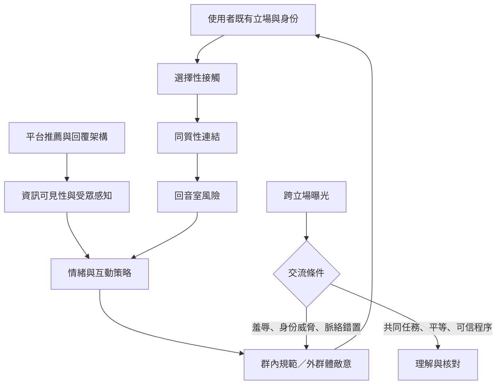

數位平台可能透過使用者選擇、同質性連結、推薦機制、回覆結構與受眾模糊性，形塑資訊接觸與互動環境。但「看見同立場內容」不等於態度必然極化；跨立場曝光也可能因身份威脅而引發防衛。

平台效應是社會心理與技術設計的交互結果，不能歸因於單一演算法。相關概念：[[term/Selective_exposure|選擇性接觸]]、[[term/Homophily|同質性連結]]、[[term/Echo_chamber|回音室]]。

## 思與行
- 社群治理同時處理資訊多樣性、互動文明與共同任務，而非只調整推薦比例。
- 將曝光、態度、情緒、互動網絡分別測量，並注意介入對不同使用者可能有不同效果。

## 參考
- [[data/降低同溫層內容曝光不一定能降低政治態度極化|Facebook 田野實驗]]。
- [[data/阿根廷實驗顯示跨立場曝光可能對既有回音室使用者產生反效果|阿根廷實驗]]。
- [[data/微博討論的受眾設計與脈絡錯置可能引發意見極化|微博受眾設計研究]]。

本書導讀：[[Group_polarization]]。
