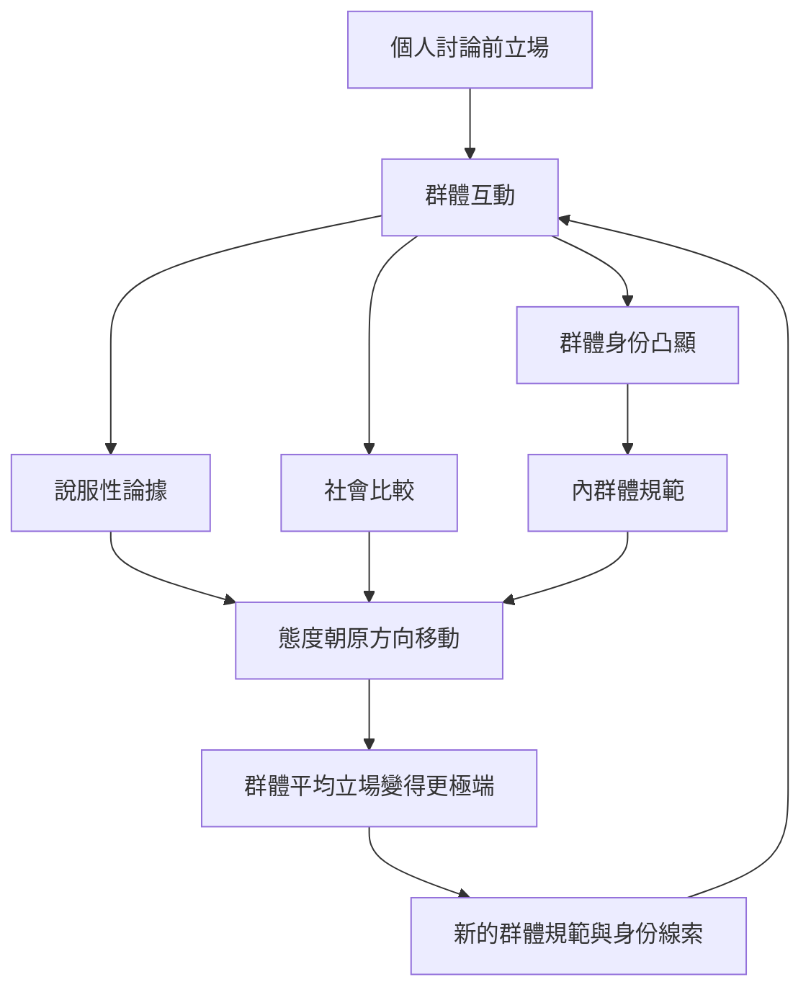

群體極化由多種社會心理歷程共同形成。成員交換論據、比較彼此立場，並依照群體身份推斷何種立場符合「我們」。認知投入程度會影響人究竟依賴簡單的群體位置訊號，還是深入處理論據品質。

這張圖呈現可能的回饋循環，而非每個群體都必然經歷的固定順序。相關理論可由[[term/Persuasive_arguments|說服性論據]]、[[term/Social_comparison|社會比較]]、[[term/Social_identity|社會認同]]與[[term/Self_categorization_theory|自我分類理論]]切入。

## 思與行
- 觀察互動中哪些發言提供新理由，哪些發言提供身份與規範訊號。
- 先讓成員獨立形成判斷，再揭露群體平均，可減少早期立場線索主導。

## 參考
- [[data/統合分析指出說服性論據與社會比較會共同促成群體極化|Isenberg 統合分析]]。
- [[data/認知投入程度會改變群體極化的主要作用機制|處理努力研究]]。
- [[data/群體認同會使成員依照內群體規範調整立場|群體認同研究]]。

本書導讀：[[Group_polarization]]。
