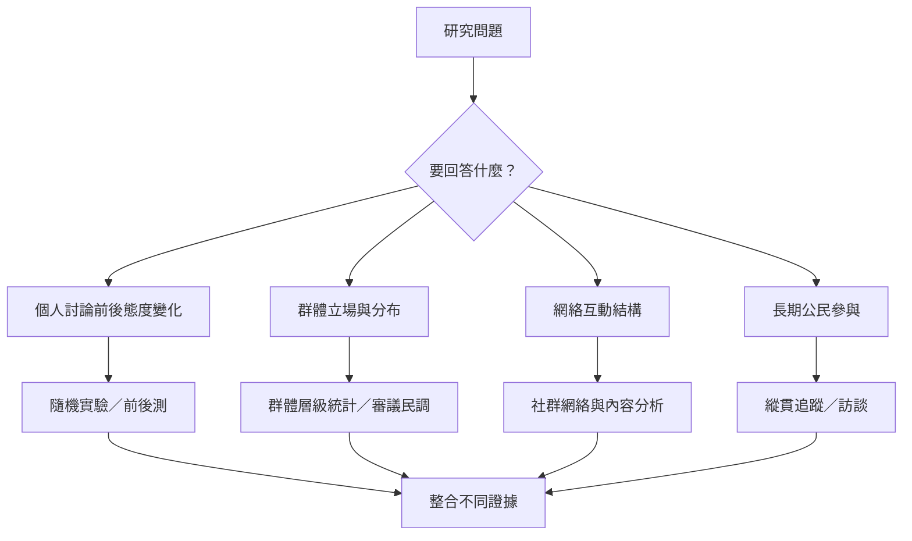

群體極化研究結合實驗、統合分析、問卷調查、社群網絡分析、內容分析與審議評估。不同方法的分析單位與推論能力不同；應先界定問題，再選擇可支持該推論的方法。

最重要的品質要求是清楚報告樣本、時間、平台、測量方式、控制條件與外推限制。觀察到網絡同質性，不代表已證明個人態度被互動改變。

## 思與行
- 每篇資料建立研究設計欄位，保存樣本、地區、方法、結果與限制。
- 用不同方法彼此校正，避免單一資料源代表全部社會。

## 參考
- [[data/群體極化的動態研究仍有大量介入效果需要真實場域驗證|動態系統回顧]]。
- [[note/研究群體極化必須區分測量層次與因果推論|測量與因果推論]]。

本書導讀：[[Group_polarization]]。
