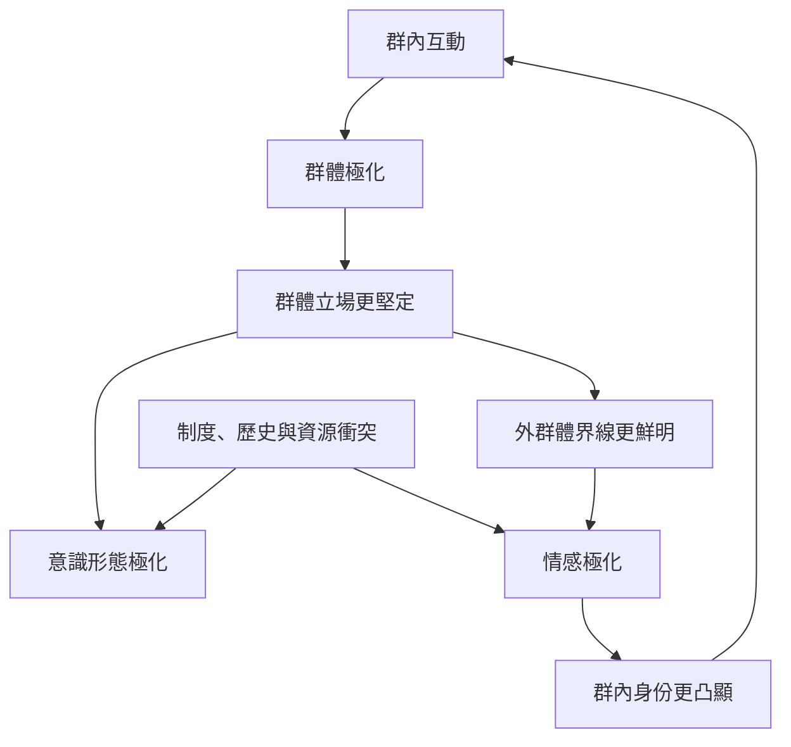

「群體極化」描述群內討論前後的態度位移；「意識形態極化」描述政治立場距離或分布兩端化；「情感極化」描述對外群體的厭惡與社會距離。這些現象可能互相強化，但需要不同測量方式。

圖中的箭頭表示可能的相互作用，不表示必然或單向因果。閱讀研究時，必須辨認作者測量了哪一層次。相關概念：[[term/Group_polarization|群體極化]]、[[term/Ideological_polarization|意識形態極化]]、[[term/Affective_polarization|情感極化]]。

## 思與行
- 同時觀察態度位移、群體分布與外群體情感，不以單一極化分數代表全部。
- 區分對政策的強烈反對，與對反對者人格的敵意。

## 參考
- [[note/群體極化不等於政治極化或情感極化|概念區辨]]。
- [[data/九國社群網絡研究發現政治互動具有跨國相似的敵我結構|九國網絡研究]]。

本書導讀：[[Group_polarization]]。
