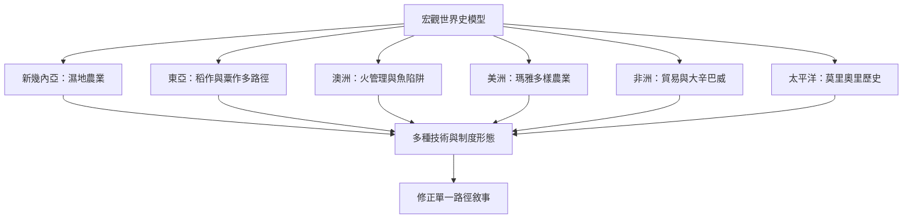

以多區域案例檢查把農業、國家、文字與金屬技術視為唯一文明標準的問題。

概念與案例：[[新幾內亞庫克沼澤提供獨立農業發展考古證據]]、[[東亞稻作與粟作呈現多區域且非同步的農業發展]]、[[澳洲原住民族以火管理形成多樣景觀]]、[[澳洲與新幾內亞石砌魚陷阱反映技術與社會合作]]、[[瑪雅低地農業不能簡化為單一玉米輪耕模式]]、[[非洲前殖民貿易需要結合考古口述與歷史資料]]、[[大辛巴威政治經濟建立於在地家庭生產與跨區交換]]、[[斯瓦希里海岸歷史顯示非洲社會長期參與跨洋網絡]]、[[莫里奧里歷史提醒島嶼比較必須尊重原住民史觀]]
