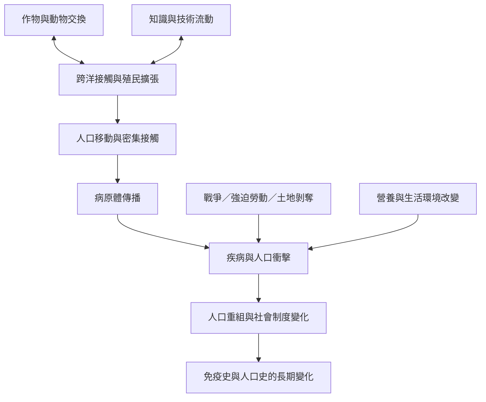

疾病傳播是生態、人口接觸和殖民制度共同作用的歷史過程；跨洋交換也包含作物、動物、技術與知識的雙向移動。

概念與案例：[[哥倫布大交換]]、[[病原體與流行病]]、[[病原體優勢來自接觸史與生態條件而非種族本質]]、[[殖民征服不能被縮減為病菌與技術優勢]]、[[美洲疾病史必須同時考察病原體殖民與社會崩解]]、[[美洲殖民改變原住民族免疫史但機制仍未完全釐清]]、[[加州考古資料顯示殖民人口崩落時間具有區域性]]
