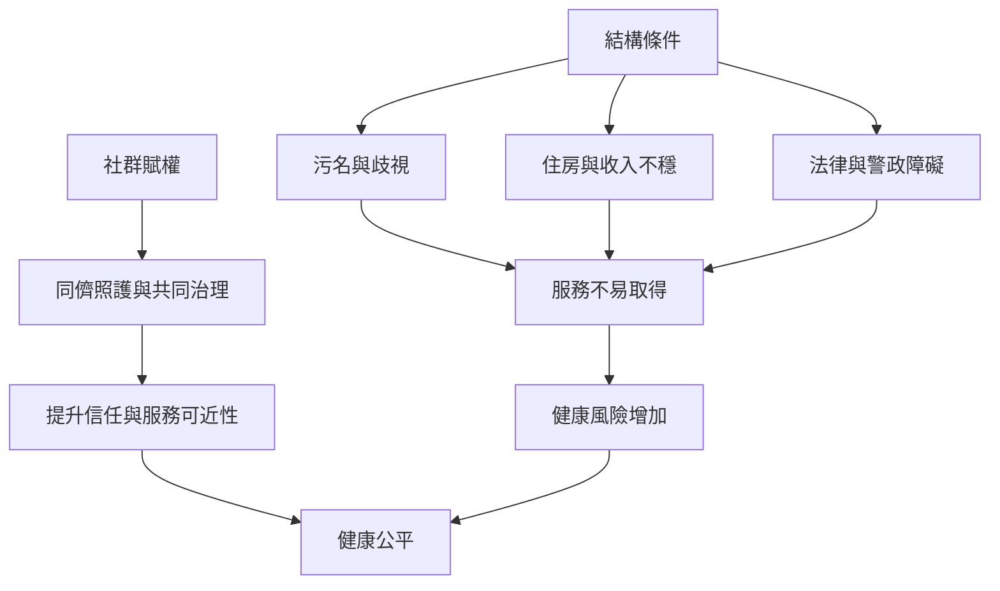

減少傷害若只處理個人行為，便容易忽略污名、刑事化、住房不穩、暴力及資源不平等。社群的參與與決策權不是裝飾，而是使政策貼近生活現場的重要知識來源。

延伸閱讀：[[減少傷害必須同時處理個人風險與制度製造的傷害]]、[[使用者社群不只是服務對象也是健康知識與政策的共同作者]]、[[社群主導的同儕照護能創造無污名且互助的服務關係]]、[[性工作者減害需要社群領導與對暴力的結構性回應]]與[[公共場所注射與過量感染及不穩定居住具有交織關聯]]。
