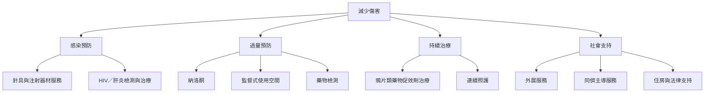

減少傷害的服務不是一種單一工具，而是依風險與需求組合的照護網絡。預防工具、急性救援、治療與持續照護互相補足；服務應以低門檻方式提供，並由社群共同設計。

閱讀時可由[[WHO 將注射藥物使用者照護定義為整合式而非單一工具]]進入，再讀[[針具與注射器材服務可降低感染風險且不會必然增加用藥]]、[[社區可取得納洛酮能在鴉片類藥物過量時挽救生命]]、[[鴉片類藥物促效劑治療與較低死亡風險相關]]及[[藥物檢測能降低資訊落差但檢測結果並非安全保證]]。
