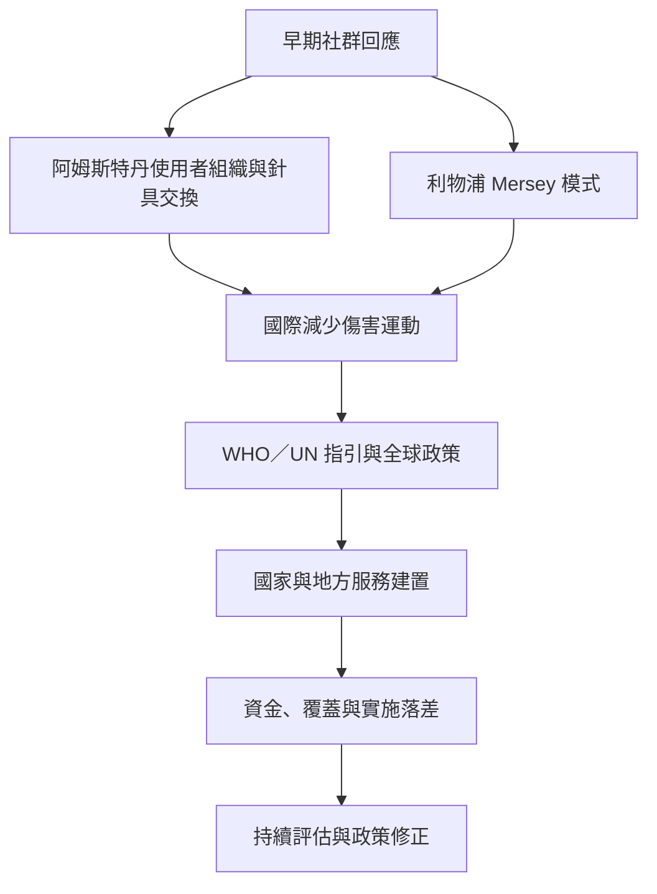

減少傷害由社群與地方公共衛生實踐逐步發展，再進入國家政策與國際指引。各地制度、資金與服務覆蓋差異很大，政策採認不能取代對實際可近性的檢查。

核心歷史案例：[[阿姆斯特丹的針具交換源自使用者組織對感染風險的回應]]、[[利物浦的 Mersey 模式把減害從理念轉化為人口層次的服務]]與[[臺灣 2005 年後的減害政策與注射 HIV 疫情變化相關]]。全球治理與資源議題見[[全球減少傷害服務增加但覆蓋率與資金仍不足]]及[[減少傷害政策的成效不能只用國家是否採認來判斷]]。
