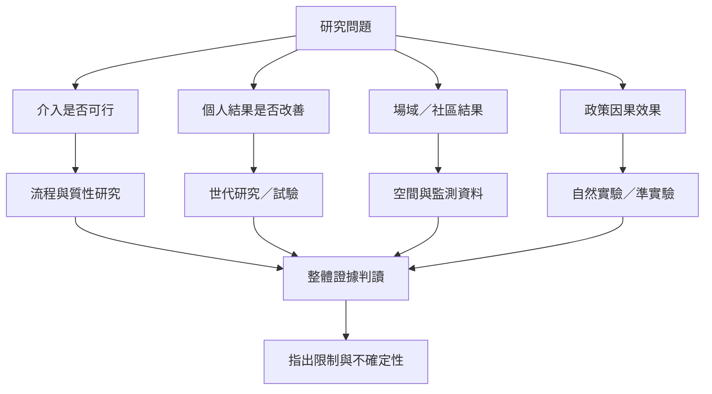

減少傷害的證據必須按照研究問題與尺度解讀。場域內救援、個人健康結果、區域人口死亡率與國家政策效果是不同問題。對爭議介入尤其需要辨識研究設計、資料品質與可能的替代解釋。

可比較的案例包括[[監督式藥物使用空間提供即時救援但人口層級成效受場域影響]]、[[英屬哥倫比亞的安全供應政策研究呈現值得追蹤的爭議證據]]、[[鴉片類藥物促效劑治療與較低死亡風險相關]]及[[臺灣 2005 年後的減害政策與注射 HIV 疫情變化相關]]。
