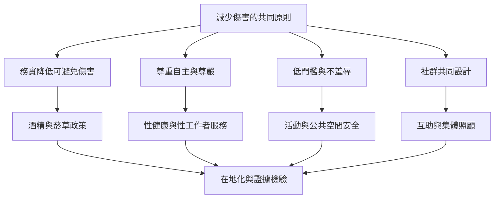

減少傷害的原則可啟發酒精政策、性健康、夜生活與社群活動的風險設計，但跨領域借用時需清楚標示各領域的證據強弱與問題差異。

領域案例見[[酒精減害需要個人照護與人口層級政策同時介入]]、[[菸草產業可能挪用減害語言替新型尼古丁產品行銷]]及[[性工作者減害需要社群領導與對暴力的結構性回應]]。行動構想見[[每個照護系統都可以先問如何讓下一步更安全]]、[[把服務入口設計成可以離開也能重新回來的路徑]]及[[減少傷害可以成為社群活動中非羞辱式安全守則的設計原則]]。
