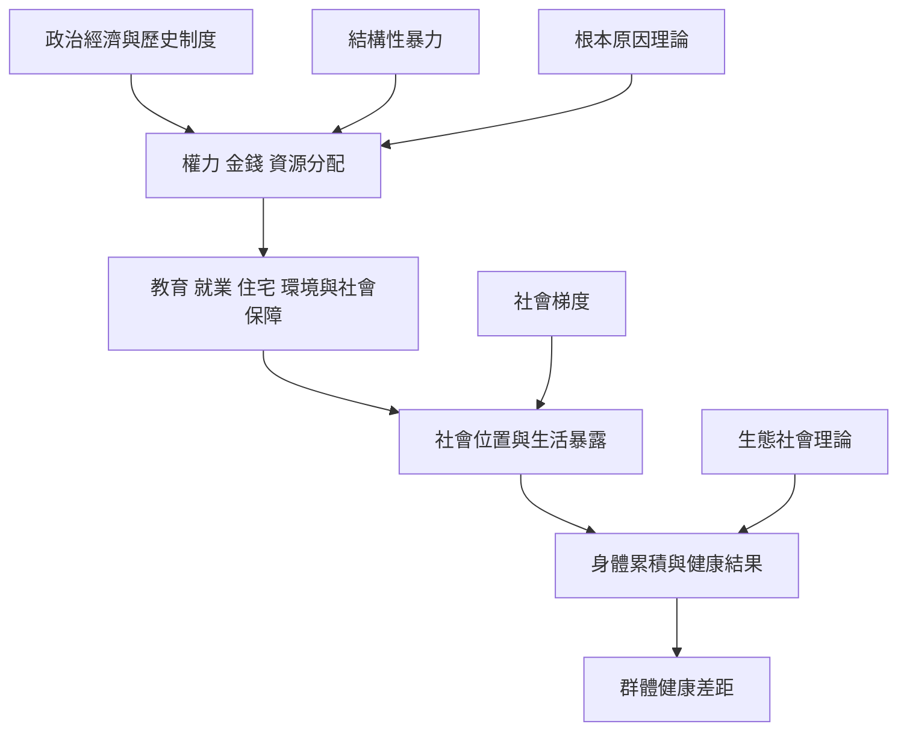

健康公平的分析可由個人與臨床經驗開始，逐層追溯社會位置、日常生活條件、制度安排與更上層的政治經濟結構。這張圖將社會決定因素、社會梯度、根本原因與生態社會理論放在同一因果脈絡中。

核心閱讀：[[note/健康的根源往往在醫療體系之外的日常生活條件]]、[[note/健康公平必須處理健康差距背後的權力與資源分配]]、[[note/社會資源的不平等會透過新舊機制持續轉化為疾病差距]]。

可延伸：[[term/健康的社會決定因素]]、[[term/社會梯度]]、[[term/結構性暴力]]、[[term/疾病的社會根本原因理論]]、[[term/生態社會理論]]。
