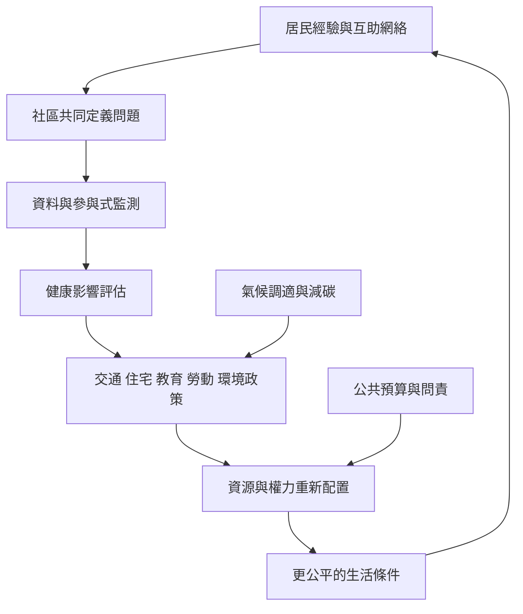

健康公平的實踐需要社區參與、跨部門合作與長期生態轉型。從地方步行、照護互助到預算參與，居民可以共同指出日常障礙；政府則須把這些知識轉成住宅、交通、環境、勞動與衛生政策。氣候危機使這些工作更加緊迫。

核心閱讀：[[idea/用步行地圖記錄一個社區的健康公平條件]]、[[idea/建立由社區共同治理的健康公平觀測站]]、[[idea/為地方預算建立健康公平影響檢核]]。

可延伸：[[term/社區參與]]、[[term/健康全方位政策]]、[[term/健康影響評估]]、[[term/健康正義]]。
