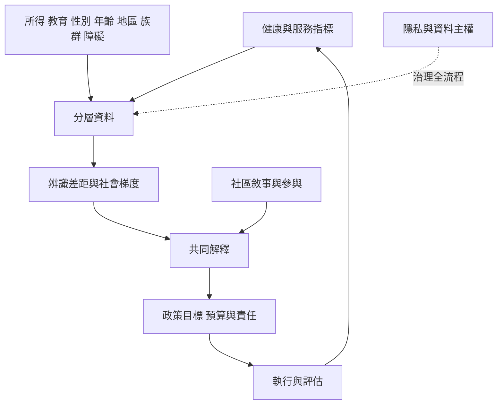

健康公平測量必須把全體平均拆解為不同群體與地區的經驗，並把健康結果與其社會決定因素連結。指標不能只用於排名，而應協助社區發現問題、追問政策責任及驗證改變。資料治理也必須保護隱私和群體權利。

核心閱讀：[[note/沒有群體分層資料就無法看見平均值掩蓋的健康不公平]]、[[note/評估政策公平性必須檢查誰獲得最多利益]]、[[note/健康公平的問責必須追溯制度造成差距的歷史責任]]。

可延伸：[[term/健康監測]]、[[term/原住民族資料主權]]、[[term/健康影響評估]]、[[term/社區參與]]。
