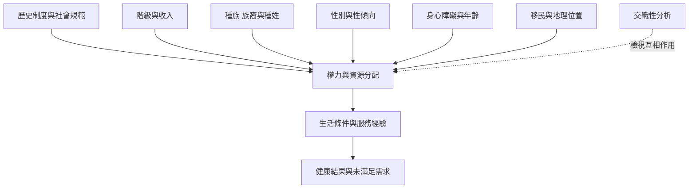

健康差距不會只沿單一收入或身分軸線分布。種族化、種姓、性別、身心障礙、移民身分、年齡與地理位置可能共同影響資源、權力、暴露和服務取得。這張圖用交織性作為分析框架，提醒研究者避免把各群體視為內部同質。

核心閱讀：[[note/健康公平分析必須把種姓與歷史性社會排除納入制度脈絡]]、[[note/性別健康差距源自權力關係而不只是生理差異]]、[[note/原住民族健康公平需要自決與共同治理而不只是增加服務]]。

可延伸：[[term/交織性]]、[[term/結構性種族主義]]、[[term/障礙正義]]、[[term/文化安全]]。
