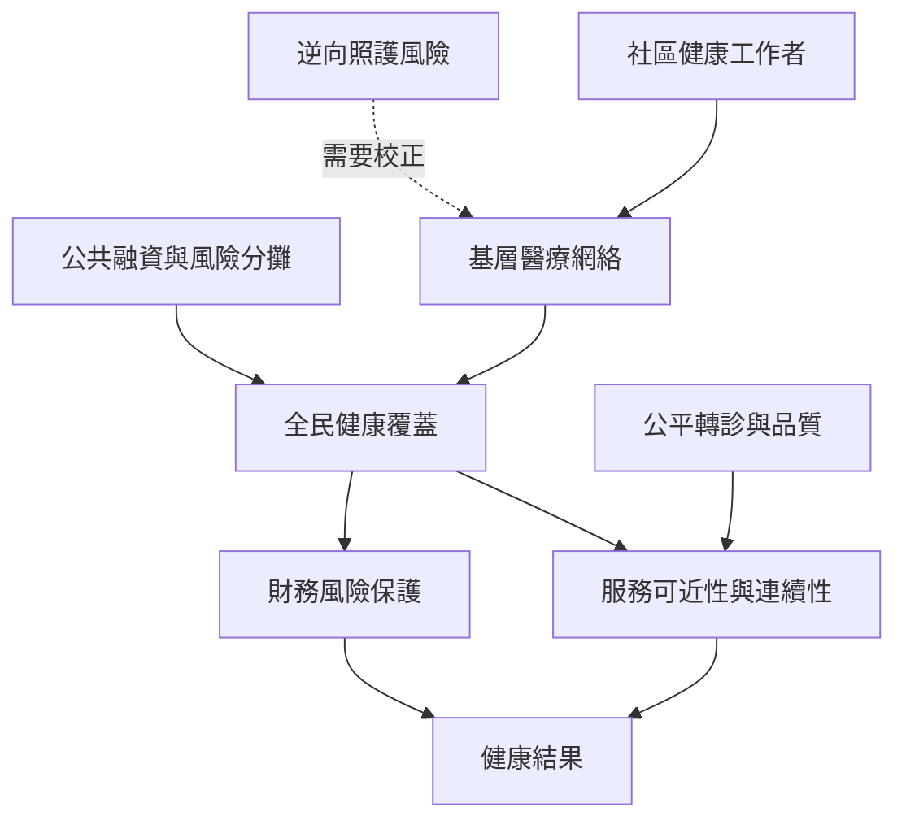

全民健康覆蓋只有在服務可近、品質足夠、照護連續且不造成財務困難時，才具有實質公平意義。基層醫療、社區健康工作者、公共融資和公平轉診是支撐這個目標的重要制度條件。

核心閱讀：[[note/全民健康覆蓋必須同時保障服務可近性與財務安全]]、[[note/基層醫療只有嵌入地方制度與社區信任才可能促進公平]]、[[note/平均增加醫療供給未必能改善需求最高群體的可近性]]。

可延伸：[[term/全民健康覆蓋]]、[[term/基層醫療]]、[[term/財務風險保護]]、[[term/反向照護定律]]。
