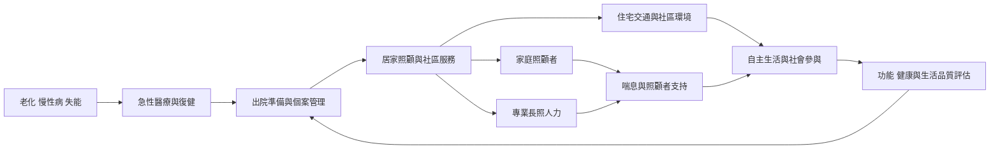

人口老化使醫療、復能、長照、社會照顧與家庭支持之間的連接變得更重要。急性醫療處理疾病事件，長期照顧則維持日常生活功能與社會參與；兩者需要在出院、居家照護與社區服務之間協調。

主線筆記包括[[長期照顧是社會照顧基礎設施而不只是醫療服務]]、[[照顧者負荷應成為長照政策的核心成效指標]]與[[健康政策的品質需要同時聽見數據與病人經驗]]。可對照[[台灣長照2.0需要同時評估服務擴張與家庭照顧負荷]]及[[日本德國加拿大呈現不同的普及醫療制度設計]]。

概念詞條：[[長期照顧]]、[[社會照顧]]、[[整合照護]]與[[照顧者負荷]]。
