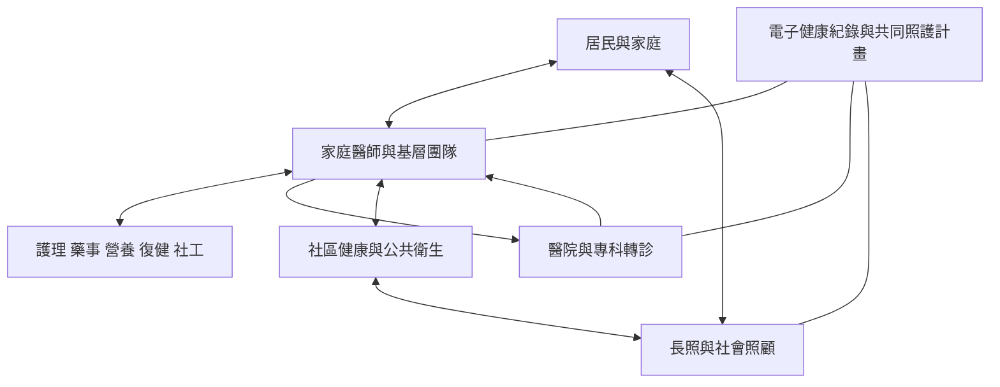

初級衛生保健把醫療服務從單次就診組織成長期關係。家庭醫師、護理師、藥師、社工、公共衛生與長照服務需要共享資訊、共同管理慢性病並在必要時轉診。台灣既有家庭醫師整合照護、偏鄉 IDS 與社區長照網絡，可成為整合照護深化的基礎。

相關核心筆記是[[自由選醫提高選擇空間卻可能削弱照護連續性]]、[[初級衛生保健是以社區與連續關係組織醫療的制度基礎]]、[[長期照顧是社會照顧基礎設施而不只是醫療服務]]。概念詞條包括[[初級衛生保健]]、[[醫療守門制度]]、[[整合照護]]、[[社區參與]]與[[電子健康紀錄]]。

可比較[[台灣基層家庭醫師整合照護已建立社區網絡但仍非強制轉診]]與[[哥斯大黎加以社區多專業團隊實踐初級衛生保健]]，思考固定照護團隊與患者自主如何平衡。
