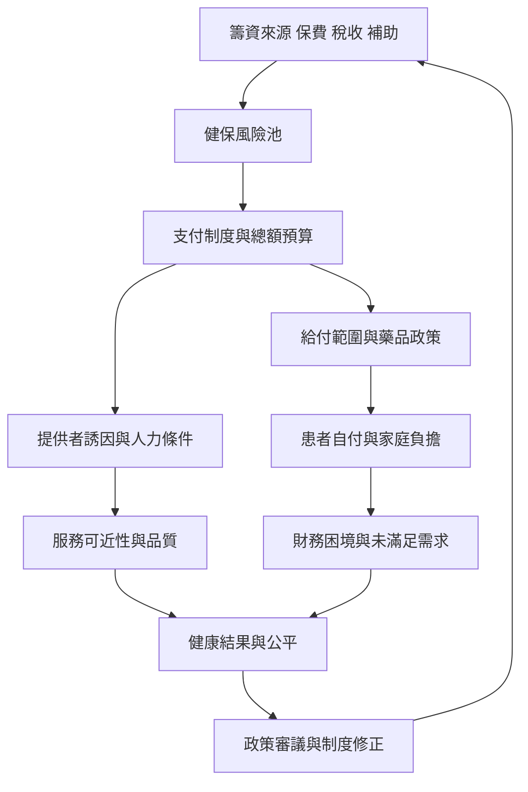

健保永續同時包含保險基金收支穩定、醫療提供者有能力提供適切服務，以及家庭不因就醫陷入財務困境。支出控制、保費與稅收、給付優先順序和患者共付額彼此牽動，不能只追求其中一項。

閱讀此圖時，可連結[[健保永續需要公開協商誰負擔成本與誰優先受益]]、[[全球總額預算能限制支出但也可能壓縮必要照護]]、[[財務保護要看家庭是否因就醫而陷入困境]]，以及[[用一張健康保障儀表板分開呈現納保可近性品質與財務風險]]。

概念上，[[全球總額預算]]與[[健康科技評估]]協助支付方分配有限資源；[[共付額]]與[[災難性醫療支出]]則用來觀察家庭是否承受過度風險。資料使用須回到[[健保自付支出統計必須先核對年份與分母]]。
