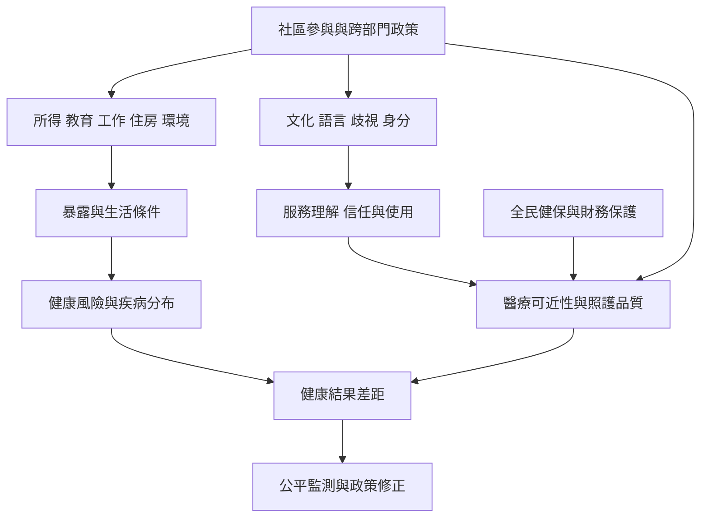

健康差距不只來自個人疾病與醫療服務供給，也受到收入、教育、工作、住房、交通、環境、語言與文化安全影響。全民健保能降低無保險障礙，但要改善公平，還需結合社會政策、社區參與與可近的基層服務。

這張圖將[[健康結果也由教育工作住房與社會支持共同塑造]]與[[醫療公平必須同時衡量納保、可近性、品質與財務保護]]連接。應特別閱讀[[台灣醫療資源的地理落差仍反映在壽命差距]]和[[原住民族與移工的健康可近性需要文化與語言支持]]。

概念詞條：[[健康公平]]、[[健康的社會決定因素]]、[[全民健康涵蓋]]、[[社區參與]]與[[文化安全]]。
