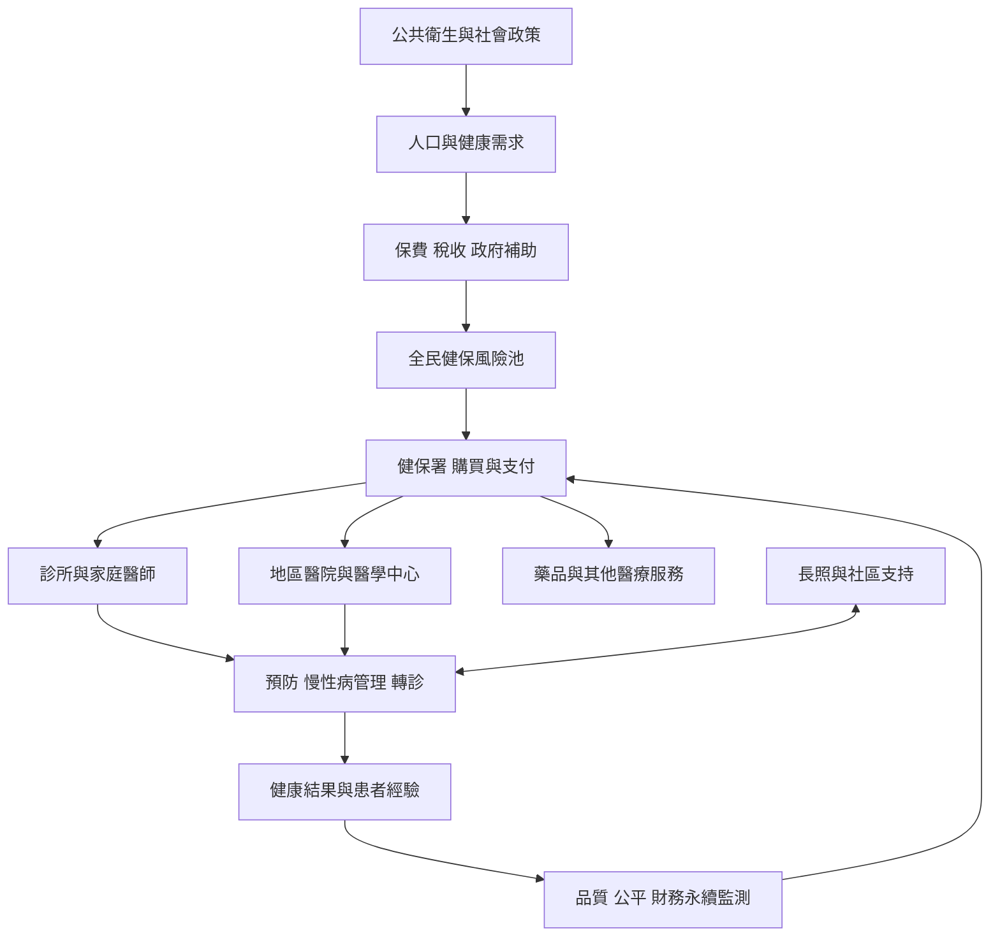

台灣醫療體系可以理解為相互依賴的四個層次：籌資與風險共擔、健保購買與支付、醫療服務提供，以及健康結果與公平監督。全民健保的單一支付者位於支付與治理核心，但實際服務由多元醫療機構提供；基層醫療、醫院、公共衛生與長照則需要協調。

這張圖連結[[全民納保不等於完整的健康保障]]、[[單一支付者能降低行政摩擦但不會自動創造充足資源]]與[[健保數位資料能促進協調但資料連通不等於整合照護]]。核心術語包括[[全民健康涵蓋]]、[[單一支付者醫療]]、[[社會健康保險]]與[[健康融資]]。

制度的主要風險是把籌資成功誤認為照護成功。真正的結果還需追蹤[[初級衛生保健]]、[[整合照護]]、[[健康公平]]和[[財務保護]]。
